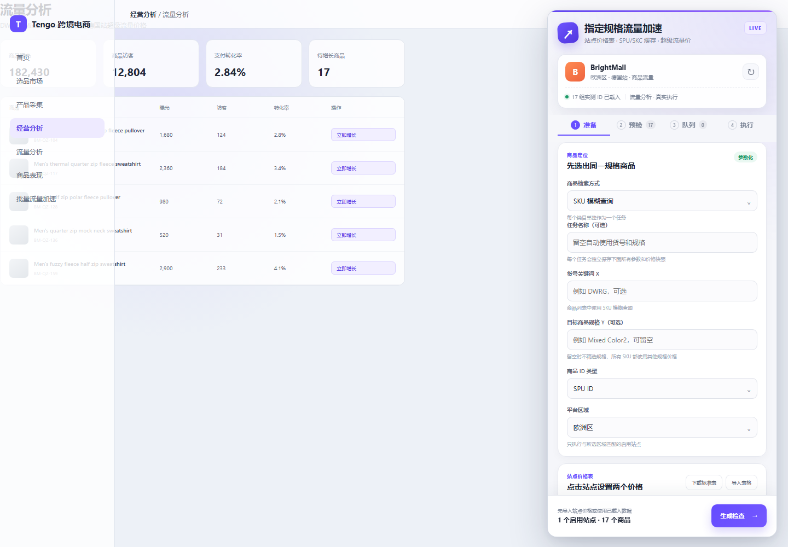

# ChatGPT Projects · Cross-Border Automation Lab

**Turn repetitive Temu operations, browser research, and product visual
production into inspectable, reusable, and portable tools.**

English · [快速开始](#three-minute-tour) · [Projects](#projects) · [Migration guide](项目迁移包清单.md)

This is not a prompt collection.

It is a set of practical projects with source code, browser extensions, tests,
launch instructions, and migration notes. You can load the extensions directly,
run the local web apps, process product data, or borrow the architecture for
your own operations platform.

Last updated: 2026-11-19

<p align="center">
  
</p>

<p align="center">
  <sub>Batch Traffic Accelerator: rule-based filtering, margin preview, controlled execution, and result tracking.</sub>
</p>

## Three-Minute Tour

### 1. Open a real interaction demo

```powershell
git clone https://github.com/leboy77/chatgpt-projects.git
cd chatgpt-projects
Start-Process .\browser-tools\batch-traffic-accelerator\demo\preview.html
```

No dependencies and no seller account are required for the static demo.

### 2. Start the Visual Forge local studio

```powershell
cd creative-tools\visual-forge-studio\backend
python -m venv .venv
.\.venv\Scripts\Activate.ps1
python -m pip install -r requirements.txt
python -m visualforge serve
```

Then open:

```text
http://127.0.0.1:8765/
```

The default mode uses a local mock provider and consumes no external image-model
credits.

### 3. Find the right entry point

- [Chinese usage guide](USAGE.md)
- [Project migration checklist](项目迁移包清单.md)
- [Codex history export](chat-tools/codex-history-export/)

## Who It Is For

- Teams operating Temu stores in the United States or Europe.
- Operators turning pricing, delisting, recoloring, and image workflows into tools.
- Developers researching browser automation, DOM behavior, CDP, and e-commerce systems.
- Builders interested in how AI conversations become runnable software.

## Projects

### Temu Operations

| Project | What it solves |
| --- | --- |
| [Global Price Declaration Checker](temu-operations/price-checker/) | Imports SKCs and country prices, compares platform and declared prices, and supports preview, batching, pause, and retry. |
| [Downlist Assistant Suite](temu-operations/downlist-assistant/) | Delisting, image archiving, ad-spend monitoring, spreadsheet workflows, and a legacy native assistant. |
| [Auto Recolor Assistant](temu-operations/auto-recolor/) | Adds color variants, fills product and back images, sets SKU attributes, submits jobs, and tracks state. |

### Collection, Analysis, and Browser Tools

| Project | What it solves |
| --- | --- |
| [Temu Product Image Collector](reverse-engineering/temu-image-collector/) | Collects product and carousel images, exports titles, filters recommendation and ad cards, and builds ZIP archives. |
| [Batch Traffic Accelerator Demo](browser-tools/batch-traffic-accelerator/) | Filters products by traffic, conversion, price, and margin, previews price reductions, and simulates batch execution. |
| [Chrome CDP Probe](browser-tools/chrome-cdp-probe/) | Connects to the Chrome DevTools Protocol using only the Python standard library. |

### Visual and Creative Production

| Project | What it solves |
| --- | --- |
| [Visual Forge Studio](creative-tools/visual-forge-studio/) | POD visual-production backend and Muse extension for logo recoloring, product colors, generation, quality checks, and archiving. |
| [Warm Sand Background Generator](creative-tools/background-generator/) | Generates reproducible product backgrounds with Python and Pillow. |

### AI Workflows

| Project | What it solves |
| --- | --- |
| [Codex History Export](chat-tools/codex-history-export/) | Exports local Codex sessions as Markdown, JSONL, attachments, and SHA-256 manifests. |
| [Temu SOP and Market Research](https://github.com/leboy77/temu-sop-agent-toolkit) | Companion repository covering EU Y2 and US Y1 POD market research and SOPs. |

## Design Principles

> **Deterministic code handles calculations; models explain; humans approve
> high-impact actions.**

- Pricing, sales windows, concentration, and task states must remain traceable.
- Lifetime sales are never treated as confirmed 30-day sales.
- CAPTCHAs, platform risk controls, and access restrictions are not bypassed.
- Automation starts with preview and small-batch validation.
- Cookies, API keys, customer data, runtime databases, and unredacted chat logs
  are never committed.

## Repository Layout

```text
temu-operations/       Temu pricing, delisting, advertising, and recoloring
reverse-engineering/   Temu page and image collection research
browser-tools/         Browser extensions and DevTools Protocol tools
creative-tools/        Visual Forge, Muse extension, and image generation
chat-tools/            Codex chat-history migration
archive/               Empty-directory and archive notes
USAGE.md               Launch instructions for all projects
项目迁移包清单.md        Cross-machine migration checklist
```

## Scope

The repository is intended for internal business tooling, workflow validation,
and engineering reference. Confirm account permissions, platform rules, data
boundaries, and image or design licensing before production use.
