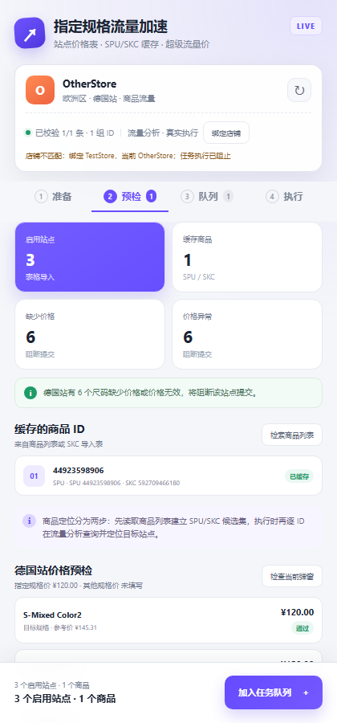
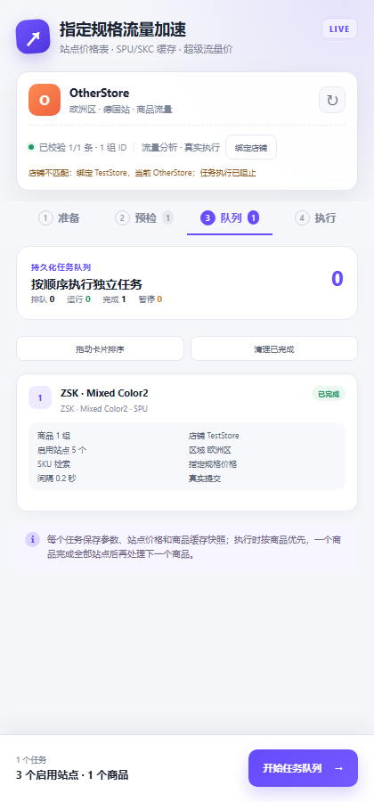

# ChatGPT Projects · 跨境电商自动化工具箱

**把重复的 Temu 操作、页面研究和商品视觉生产，变成可检查、可复用、可迁移的工具。**

[English](README.en.md) · [快速开始](#三分钟体验) · [项目目录](#项目目录) · [迁移指南](项目迁移包清单.md)

这不是一份提示词合集。

这里是一组已经拆到源码、浏览器扩展、测试、运行说明和迁移清单的实用项目。
你可以直接加载扩展、启动本地网页、处理商品数据，也可以把其中的流程拆走，
改造成自己的运营系统。

最近更新：2026-11-19

<p align="center">
  
  
</p>

<p align="center">
  <sub>指定规格流量加速 v0.6.17：商品预检、站点价格校验和持久化任务队列。</sub>
</p>

## 三分钟体验

### 1. 加载一个当前可运行的扩展

打开 `chrome://extensions`，开启开发者模式，选择“加载已解压的扩展程序”：

```text
browser-tools\batch-traffic-accelerator
```

进入 Temu 商品列表后，从侧边栏完成商品检索、站点价格配置、任务预检和队列执行。

### 2. 启动 Visual Forge 本机工作台

```powershell
cd creative-tools\visual-forge-studio\backend
python -m venv .venv
.\.venv\Scripts\Activate.ps1
python -m pip install -r requirements.txt
python -m visualforge serve
```

打开：

```text
http://127.0.0.1:8765/
```

默认使用本地演示模型，不消耗外部 API 额度。

### 3. 找到适合你的入口

完整安装和操作说明：

- [使用入口与操作方法](USAGE.md)
- [全部项目迁移清单](项目迁移包清单.md)
- [Codex 聊天记录导出](chat-tools/codex-history-export/)

## 适合谁

- 正在运营 Temu 美国、欧洲站点，想减少重复操作的团队。
- 想把核价、下架、复色和图片流程工具化的业务负责人。
- 需要研究浏览器页面、DOM、CDP 和电商工作流的开发者。
- 想参考“从 AI 对话到可执行工具”完整落地过程的人。

## 项目目录

### Temu 运营

| 项目 | 解决什么问题 |
| --- | --- |
| [全球价格申报核价助手](temu-operations/price-checker/) | 批量导入 SKC 与国家价格，支持 RMB/USD、汇率、查询完整性校验、预览、分批和重试。 |
| [下架助手合集](temu-operations/downlist-assistant/) | 处理下架、主图归档、广告花费监控、Excel 清单和旧版本地助手。 |
| [商品自动复色助手](temu-operations/auto-recolor/) | 批量新增色值、补主图与背面图、填写规格、提交任务并回写状态，当前版本 `0.10.15`。 |

### 采集、分析与浏览器工具

| 项目 | 解决什么问题 |
| --- | --- |
| [Temu 商品首图采集器](reverse-engineering/temu-image-collector/) | 四种采集模式，支持自动翻页、预览筛选、重复过滤和图片链接导出。 |
| [指定规格流量加速](browser-tools/batch-traffic-accelerator/) | 缓存 SPU/SKC、导入站点价格、预检流量资格，并通过持久化队列提交真实加速任务。 |
| [Chrome CDP 页面探针](browser-tools/chrome-cdp-probe/) | 用 Python 标准库连接 Chrome DevTools Protocol，检查页面和网络事件。 |

### 视觉与创意生产

| 项目 | 解决什么问题 |
| --- | --- |
| [Visual Forge Studio](creative-tools/visual-forge-studio/) | POD 视觉生产后端、Muse `0.13.1` 扩展和团队看板，支持图片与视频任务、校色、质检和归档。 |
| [暖砂图腾背景生成器](creative-tools/background-generator/) | 用 Python 和 Pillow 生成可复现的商品背景图。 |

### AI 工作流

| 项目 | 解决什么问题 |
| --- | --- |
| [Codex History Export](chat-tools/codex-history-export/) | 把本机 Codex 会话导出为 Markdown、JSONL、附件和 SHA-256 校验清单。 |
| [Temu SOP 与市场研究](https://github.com/leboy77/temu-sop-agent-toolkit) | 独立仓库，包含欧洲 Y2、美国 Y1 POD 的市场分析与运营框架。 |

## 这个仓库的设计原则

> **确定性的计算交给脚本，模型负责解释；高风险动作交给人工确认。**

- 价格、销量窗口、集中度和任务状态必须可追溯。
- 不把累计销量当成近 30 天销量。
- 不绕过验证码、平台风控和访问限制。
- 自动操作先预览、小批量验证，再扩大范围。
- 不提交 Cookie、API Key、客户数据、运行数据库和未脱敏聊天记录。

## 仓库结构

```text
temu-operations/       Temu 核价、下架、广告监控和自动复色
reverse-engineering/   Temu 页面与图片采集分析
browser-tools/         浏览器扩展和 DevTools Protocol 工具
creative-tools/        Visual Forge、Muse 扩展和图像生成
chat-tools/            Codex 聊天历史迁移
archive/               空目录与归档说明
USAGE.md               所有项目的打开方式
项目迁移包清单.md       跨电脑迁移和依赖核对
```

## 使用边界

项目用于自有业务工具开发、流程验证和工程参考。正式操作前，请确认账号权限、
平台规则、数据边界、图片版权和图案商用授权。
