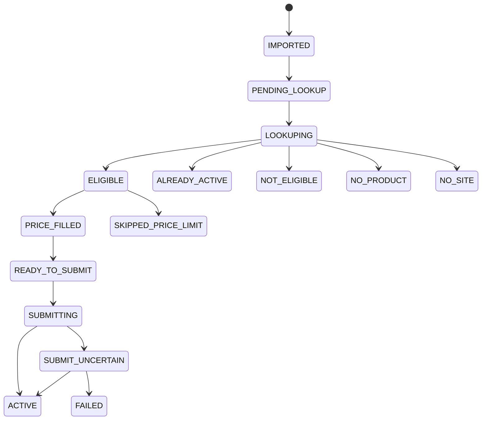

# 批量指定规格流量加速器技术方案

## 1. 目标

在 BitBrowser 的 Temu 商家后台中实现一个本地 Chromium 扩展。扩展读取 Excel，查询商品加速资格，并按 SKU 名称将指定颜色组价格设为 Y、其他 SKU 价格设为 X。所有操作使用当前浏览器已登录会话，不建立远端服务。

## 2. 已确认的平台事实

| 场景 | 观测结果 |
| --- | --- |
| 页面 | `agentseller-eu.temu.com/main/flux-analysis` |
| 区域 | 全球、美国、欧区；当前默认在欧区 |
| 查询类型 | 可选 `SKC` |
| 批量输入 | 提示支持空格或逗号分隔 |
| 3 个 SKC 查询 | 结果总数 36，每页 30 条 |
| 单 SKC 查询 | `111111111111` 返回 19 个站点 |
| 结果行标识 | 显示 `SPU ID` 和经营站点，不直接显示输入查询的 SKC |
| 开启入口 | “该商品已获得开启流量加速器机会 立即开启” |
| 加速弹窗 | 默认持续 30 天，自动续期开启 |
| 停止限制 | 开启后至少 7×24 小时才能手动停止 |
| 自定义价格入口 | “继续让价获取更多流量，去获取” |
| 价格页标题 | “调整申报价” |
| 价格列 | 日常申报价格、超级流量加权申报价格、参考申报价 |
| SKU 结构 | 颜色组下分 6 个尺码，名称形如 `S-Mixed Color2` |
| 价格校验 | 超过参考申报价时提示“不得高于超级流量加权的参考申报价” |

德国站 `111111111111` 的实测上限：

- `Mixed Color2`：114.25。
- 非目标颜色组最低上限：118.38。
- 当前输入 Y=115、X=125 均存在超限行，不能提交。

## 3. 总体架构

采用 Manifest V3 扩展，优先注入页面内浮动面板，以兼容当前 BitBrowser 环境。

```text
浮动面板 iframe
   |
   | window.postMessage
   v
Temu content script
   |
   +---- 页面 DOM 适配器：点击、读取表格、填写价格、验证结果

浮动面板 iframe <---- chrome.storage.local：任务和结果持久化
```

### 3.1 模块

1. `panel`：Excel 导入、任务队列、状态机、区域选择、执行控制、持久化、结果导出。
2. `content`：与 Temu 页面交互，等待页面稳定，读取状态，填写价格并自动提交。
3. `storage`：`chrome.storage.local` 保存任务和运行结果。
4. `excel`：使用本地打包的 SheetJS 读取 XLSX，不依赖 CDN。

### 3.2 浮动面板

- 通过 content script 创建固定定位容器。
- 面板放在 Shadow DOM 或独立 iframe 中，隔离 Temu 页面样式。
- 支持拖动和折叠，不遮挡页面底部主按钮。
- 页面刷新后从 `chrome.storage.local` 恢复任务列表和已完成结果。

## 4. 数据模型

### 4.1 任务

```ts
type TaskStatus =
  | "IMPORTED"
  | "PENDING_LOOKUP"
  | "LOOKUPING"
  | "ELIGIBLE"
  | "ALREADY_ACTIVE"
  | "NOT_ELIGIBLE"
  | "NO_PRODUCT"
  | "NO_SITE"
  | "SKIPPED_PRICE_LIMIT"
  | "PRICE_FILLED"
  | "READY_TO_SUBMIT"
  | "SUBMITTING"
  | "SUBMIT_UNCERTAIN"
  | "ACTIVE"
  | "FAILED";

interface AccelerationTask {
  taskId: string;
  runId: string;
  region: "EU" | "US" | "GLOBAL";
  skcId: string;
  spuId?: string;
  siteName: string;
  targetColorGroup: string;
  targetPriceCents: number;
  genericPriceCents: number;
  skcOrder: number;
  siteOrder: number;
  status: TaskStatus;
  reasonCode?: string;
  expectedTargetPriceCents?: number;
  expectedGenericPriceCents?: number;
  targetReferenceCapCents?: number;
  genericReferenceCapCents?: number;
  overLimitSkus?: Array<{
    skuLabel: string;
    desiredPriceCents: number;
    referencePriceCents: number;
  }>;
  attempts: number;
  lastError?: string;
  createdAt: number;
  updatedAt: number;
  submittedAt?: number;
  verifiedAt?: number;
}
```

`taskId` 使用稳定散列：`hash(runId|region|skcId|siteName|targetColorGroup)`。

`skcOrder` 取 SKC 在导入表中的首次出现顺序，`siteOrder` 取站点在价格表中的顺序。调度器先按 `skcOrder`、再按 `siteOrder` 排序。

```ts
interface SkcRunGroup {
  skcId: string;
  skcOrder: number;
  siteTasks: AccelerationTask[];
}
```

### 4.2 当前 SKC 查询缓存

```ts
interface SiteLookupRecord {
  key: string;             // region|skcId|siteName
  region: string;
  skcId: string;
  spuId: string;
  siteName: string;
  status: "ELIGIBLE" | "ACTIVE" | "NOT_ELIGIBLE";
  observedAt: number;
}
```

单个 SKC 查询后可以关联到它返回的 SPU 和站点。该查询结果只在该 SKC 的执行组内复用；切换下一个 SKC 时重新查询，避免不同 SKC 之间误匹配。

### 4.3 价格行

```ts
interface PriceRowSnapshot {
  skuLabel: string;
  dailyPrice: number;
  referencePrice: number;
  inputPath: string;
  isTarget: boolean;
  desiredPrice: number;
  finalPrice?: number;
}
```

金额内部使用整数分，读取和展示时再转成两位小数，避免浮点误差。

## 5. Excel 解析

### 5.1 推荐单表

按表头别名识别：

- SKC：`SKC ID`、`SKC`。
- 站点：`站点`、`经营站点`。
- 指定颜色组：`指定颜色组`、`指定规格`；缺省为 `Mixed Color2`。
- Y：`指定规格价格 Y`、`指定规格价格`。
- X：`通用规格价格 X`、`通用规格价格`。

### 5.2 旧版双表

- 从价格表读取站点和 X/Y。
- 从 SKC 表读取 SKC。
- 自动生成 SKC × 全部价格站点的任务组合。
- 在 UI 中显示“3 个 SKC × 2 个价格站点 = 6 条任务”。
- 任务按 SKC 首次出现顺序分组，组内按价格表站点顺序排列。
- 导入完成后不要求人工确认组合方式。

### 5.3 校验

- SKC 一律转字符串，去除首尾空格。
- 站点必须在已知站点字典中。
- 站点名称写入任务前统一去除空格和括号备注，并补全“站”后缀。
- 同一任务键不得有不同 X/Y。
- 数值使用十进制解析，拒绝负数、0、NaN 和超过两位小数的输入。
- 空行跳过，空任务表报错，不产生假成功。

## 6. 页面适配器

定义接口，业务状态机不直接依赖 CSS 选择器。

```ts
interface FluxPageAdapter {
  selectRegion(region: Region): Promise<void>;
  searchSkcs(skcIds: string[]): Promise<void>;
  readResultRows(): Promise<ResultRow[]>;
  findTaskRow(task: AccelerationTask): Promise<ResultRow | null>;
  readEligibility(row: ResultRow): Promise<Eligibility>;
  openAcceleration(row: ResultRow): Promise<void>;
  openCustomPriceForm(): Promise<void>;
  readPriceRows(): Promise<PriceRowSnapshot[]>;
  fillPriceRow(path: string, cents: number): Promise<void>;
  confirmPriceForm(): Promise<void>;
  submitAcceleration(): Promise<void>;
  verifyActive(task: AccelerationTask): Promise<boolean>;
}
```

### 6.1 区域

- `GLOBAL` 匹配链接文字“全球”。
- `US` 匹配“美国”。
- `EU` 匹配“欧区”。
- 切换后等待页面标题、区域文本和结果列表同时稳定。

### 6.2 结果行

- 以 `经营站点` 和 `SPU ID` 建立行键。
- 商品标题只用于诊断，不参与唯一匹配。
- 使用缓存将任务的 SKC 映射到 SPU。
- 结果行跨页时通过翻页和结果总数确认覆盖。
- 找不到站点行时返回 `NO_SITE`，找到站点但无资格文案时返回 `NOT_ELIGIBLE`。

### 6.3 文案指纹

集中维护以下关键文案：

- `该商品已获得开启流量加速器机会`
- `立即开启`
- `流量加速中`
- `继续让价获取更多流量`
- `去获取`
- `调整申报价`
- `超级流量加权申报价格`
- `确认`
- `立即加速`

任一关键节点找不到时抛出 `UI_VERSION_CHANGED`，全局暂停写入。不得按固定坐标继续点击。

## 7. SKU 识别和填写

### 7.1 识别规则

```text
normalizeLabel(s) =
  trim
  replace [‐‑‒–—] with -
  collapse whitespace
  lower case

isTarget =
  normalizeLabel(skuLabel).endswith(
    "-" + normalizeLabel(targetColorGroup)
  )
或当平台使用本地化后缀格式时：

  normalizeLabel(skuLabel) = normalizeLabel(targetColorGroup) + "-" + size
```

该规则覆盖 `S-Mixed Color2` 到 `XXXL-Mixed Color2`，不把单独的 `Mixed Color2` 颜色组标题误当 SKU。
同时支持中文页面使用的 `混合色-S` 到 `混合色-XXXL`。指定规格 / 颜色组由面板参数提供并持久化，导入和继续运行时应用到任务。

### 7.2 填写值

- 目标 SKU：Y。
- 其他 SKU：X。
- 每行都读取该行参考申报价。
- 任意一行 `desiredPrice > referencePrice` 时，任务标记 `SKIPPED_PRICE_LIMIT`。
- 不点击“一键填写”，因为它会按平台推荐值覆盖业务指定的 X/Y。

### 7.3 React 输入

Temu 页面使用受控输入组件。直接设置 `input.value` 不一定触发组件状态，需使用原生 setter 并派发事件：

```js
const setter = Object.getOwnPropertyDescriptor(
  HTMLInputElement.prototype,
  "value"
).set;

setter.call(input, value);
input.dispatchEvent(new Event("input", { bubbles: true }));
input.dispatchEvent(new Event("change", { bubbles: true }));
input.blur();
```

填写完成后逐行回读，并要求：

- 行数一致。
- 每个 SKU 的目标/非目标分类一致。
- 输入值按分比较一致。
- 没有错误提示。

## 8. 状态机和执行顺序



调度器采用“SKC 外层、站点内层”的两级循环。执行顺序固定为：

1. 读取任务和缓存。
2. 按 `skcOrder` 取当前 SKC，收集该 SKC 的全部站点任务。
3. 查询当前 SKC 的资格和站点结果。
4. 按 `siteOrder` 依次处理当前 SKC 的每个站点。
5. 为可开启站点读取价格上限并完成预校验。
6. 超限站点标记为 `SKIPPED_PRICE_LIMIT`，不填写、不提交，继续当前 SKC 的下一个站点。
7. 合法站点自动填写价格、回读校验、点击“确认”和“立即加速”。
8. 回到列表验证该站点是否已加速。
9. 当前 SKC 的所有站点都进入终态后，才取下一个 SKC。
10. 全部 SKC 结束后生成汇总结果。

任何任务在进入 `SUBMITTING` 前都必须有完整价格快照。

`READY_TO_SUBMIT` 是自动预检完成状态，不是人工审批状态。它在价格行回读和错误检查通过后立即自动进入 `SUBMITTING`。

## 9. 批量、限流和恢复

- 初始查询批量大小设为 20，可通过配置降低。
- 若平台提示数量过多，按 `20 -> 10 -> 5 -> 1` 自动缩小。
- 当前 SKC 查询一次后复用结果处理该 SKC 的多个站点，避免重复查询。
- 调度器一旦进入某个 SKC，在它所有站点进入终态前不得切到下一个 SKC。
- 遇到限流或网络错误，当前批次暂停，指数退避后继续。
- 单个 SKC 查询最多尝试 3 次，每次上限 90 秒。
- 三次查询失败后，仅将该 SKC 的任务标记失败并继续下一个 SKC；其他致命 UI 错误仍停止批次。
- 查询读取必须等到结果总数或结果行签名变化，最长等待 30 秒；不得用旧列表作为新查询结果。
- `RESULT_PAGINATION_FAILED` 按当前 SKC 的可重试错误处理。
- 开启和提交永远串行。
- 同一任务在 2 次明确失败后停止重试。
- 价格超限不重试，直接记录为跳过并继续下一条。
- 未找到“立即加速”按钮时，将 `SUBMIT_BUTTON_NOT_FOUND` 记录为单站点跳过，不计入致命错误，也不停止批次。
- 点击提交后超时或页面卸载，标记 `SUBMIT_UNCERTAIN`，禁止直接重试。
- 重启后先查询页面状态，再决定继续或跳过。
- 恢复任务时自动迁移旧站点名称；原因为旧名称不匹配的 `NO_SITE` 任务重新进入待执行。
- 再次启动只挑选待执行、处理中、失败和提交未知任务；终态结果保持不变。

## 10. 安全约束

- 所有数据保存在本机扩展存储中。
- 不读取或保存密码、Cookie、浏览器指纹、聊天内容。
- 不向非 Temu 域名发送 SKC、价格或页面数据。
- 不调用未确认的写接口；开启和提交优先复用页面现有 UI。
- 执行前自动完成价格上限校验，并在运行面板展示结果，不设置人工确认阻断。
- 页面出现未知文案、字段缺失、行数变化时停止，不按坐标猜测。
- 平台提示“至少 7×24 小时才能手动停止”、自动续期和 30 天周期时，面板必须持续展示，且不自动修改平台默认值。

## 11. 日志和导出

每次运行记录：

- 运行 ID、区域、开始和结束时间。
- 导入文件名、工作表、有效行数和组合方式。
- 每条任务的 SKC、SPU、站点和状态。
- 平台最低价格上限、目标组上限、超限 SKU 列表。
- 实际填写数量、逐 SKU 最终加速提价、价格类型、参考申报价、失败原因和重试次数。
- 超限任务的目标组上限、非目标组最低上限、超限 SKU 列表和期望 X/Y。
- 提交时间、验证时间及最终页面状态。

日志不记录完整页面 HTML、Cookie 或账号凭据。导出结果至少包含任务原始列、状态、原因、参考价上限、实际 X/Y 和时间；主表提供最终加速提价明细，并通过“最终价格明细”工作表按 SKU 逐行导出最终提价、价格类型和参考申报价。

## 12. 测试方案

### 12.1 数据测试

- SKC 纯数字、长数字和前导零。
- 单 SKC、多 SKC、重复 SKC。
- 同一 SKC 多站点。
- X/Y 为整数、两位小数、0、负数、空值。
- 双表文件自动按 SKC × 全部价格站点展开，不要求人工确认。
- 调度顺序必须严格为 `SKC1-站点1`、`SKC1-站点2`、`SKC2-站点1`、`SKC2-站点2`。
- 当前 SKC 尚有站点未到终态时，禁止出现下一个 SKC 的执行事件。

### 12.2 页面测试

- 可开启、已加速、无资格、无站点、无商品。
- 单页返回和跨页返回。
- 批量大小触发限制后自动降批。
- 页面刷新、弹窗关闭、登录失效和网络超时。
- 输入价格等于上限、低于上限、高于上限。
- 目标颜色组大小写、空格和不同尺码。
- 其他颜色组名称缺失或数量变化。
- 合法价格自动点击“确认”和“立即加速”，执行过程不出现人工确认弹窗。
- 价格超限只结束当前站点任务，然后继续当前 SKC 的下一个站点。

### 12.3 当前样例验收

1. 查询 3 个 SKC 时能读取 36 条站点结果。
2. 查询 `111111111111` 时能识别德国站可开启。
3. 德国站价格页能识别 36 个输入行。
4. 所有 `*-Mixed Color2` 识别为目标行。
5. Y=115 被判为超限，目标行上限为 114.25。
6. X=125 被判为超限，因为部分其他颜色组上限为 118.38。
7. 该任务显示为 `SKIPPED_PRICE_LIMIT`，结果中包含目标组和非目标组的超限原因。
8. 插件继续处理当前 SKC 的下一个站点，不提前进入下一个 SKC。
9. 不点击超限任务的最终确认和立即加速。
10. 执行过程不要求人工确认。

## 13. 分阶段实施

### P0 页面识别

- 读取区域、结果行、站点、SPU 和资格状态。
- 读取加速弹窗和价格行。
- 完成价格上限校验。

### P1 单任务执行

- 导入一条任务。
- 打开一个可开启商品。
- 填写全部 X/Y。
- 自动完成价格确认、立即加速和提交后重新查询验证，不出现人工确认。

### P2 批量执行

- 按 SKC 分组、组内按站点执行的队列。
- 当前 SKC 全部站点完成后才进入下一个 SKC。
- 批量查询、分页、暂停、继续和恢复。
- 导出结果日志。

### P3 稳定性

- 文案指纹和页面版本兼容。
- 限流退避和断点恢复。
- 提交结果未知的重新核对。

## 14. 已确认的超限处理

当前样例不能按原值执行：

- 德国站目标组上限 114.25，Y=115。
- 德国站非目标组最低上限 118.38，X=125。

已确认策略：

1. 整条 `SKC + 站点` 任务跳过。
2. 不自动截断或修改 X/Y。
3. 结果状态为 `SKIPPED_PRICE_LIMIT`。
4. 结果记录期望价格、行级平台上限和超限 SKU。
5. 继续处理后续任务，不停止整批。

如果价格页已经打开，应取消并关闭，不触发“确认”或“立即加速”。

## 15. 当前实现

- Manifest V3 扩展位于仓库根目录，可直接加载。
- 页面面板通过独立 iframe 注入，使用 `window.postMessage` 调用 content script。
- Excel 使用本地打包的 SheetJS 解析，不访问外网。
- 当前 SKC 查询结果用于该 SKC 的站点循环，全部站点结束后再次查询验证。
- 自动执行、价格超限跳过和结果导出已实现。
- 指定规格 / 颜色组已改为面板参数，支持英文 `Mixed Color2` 和中文“混合色”等本地化 SKU 标签；仅存在一个目标颜色组时允许 X 组数量为 0。
- 价格提交前逐 SKU 回读最终值，任务详情保存价格快照；导出主表写入最终提价摘要，并生成“最终价格明细”工作表。
- 站点名称标准化、查询超时重试和断点续跑已实现。
- 自动测试覆盖 Excel 双表展开、SKC/站点顺序、结果读取、价格超限和自动提交点击路径。
- 已在 测试窗口 的 BitBrowser 中使用实际 XLSX 连续完成多组真实页面批跑，验证站点顺序、查询刷新、断点恢复和结果导出。
- 0.1.7 实测批次完成 240 条站点任务：156 条运行前已加速、84 条未进入站点、0 条失败。
- 实测账号的“流量加速器待开启”筛选为“暂无数据”，因此本批没有新提交站点；不会伪造最终价格，空明细由真实状态导致。
- 自动测试覆盖价格回读快照、主表最终价格摘要和“最终价格明细”工作表行生成。
