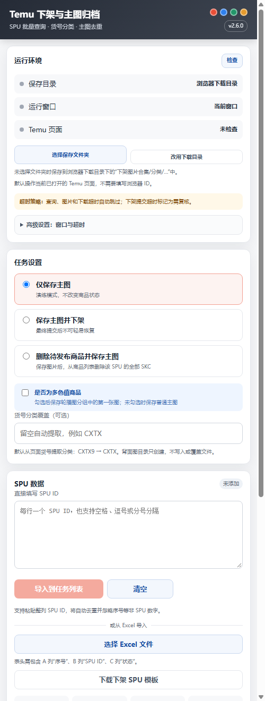

# Temu 下架与主图归档扩展



这是一个可直接加载的 Chrome MV3 浏览器扩展，不依赖 Windows 本地助手、Python、C# 或固定本机端口。每个浏览器实例独立运行，适合多店铺、多窗口同时使用。

## 文件保存方式

插件提供两种保存方式：

1. 选择自定义文件夹：首次选择一个保存位置，插件会在其中创建 `下架图片合集`。
2. 浏览器下载目录：未选择文件夹时，自动保存到浏览器下载目录下的 `下架图片合集`。

输出结构：

```text
下架图片合集/
└── CXTX/
    ├── 主图保存/
    │   └── 8780418723_主图_01.jpeg
    └── 背面图保存/
```

“背面图保存”只创建空目录，不写入、移动或覆盖已有模板。

分类默认从页面货号自动提取：

```text
CXTX9 → CXTX
```

## Excel 格式

| A | B | C |
|---|---|---|
| 序号 | SPU ID | 状态 |

SPU 请按文本保存，避免 Excel 转换为科学计数法。空白模板位于：

```text
templates\下架SPU模板.xlsx
```

也可以在插件“SPU 数据”区域点击“下载下架 SPU 模板”直接获取。
模板已预填 `1-100` 序号和 100 条空白数据行，只需填写 B 列 SPU ID；未填写 SPU 的空白行会自动跳过。

## 直接填写 SPU

插件“SPU 数据”区域支持直接粘贴 SPU ID，不需要先制作 Excel。

- 每行一个 SPU ID。
- 也可以使用空格、逗号、中文逗号或分号分隔。
- 自动忽略序号等不足 8 位的数字。
- 自动去重；重复 SPU 只保留第一次出现的记录。
- 点击“导入到任务列表”，或在输入框中按 `Ctrl+Enter`。

直接填写的任务与 Excel 导入任务共用同一套查询、图片保存、下架、失败重试和结果导出流程。

## 安装扩展

1. 完整解压最新版 ZIP。
2. 在 Chrome 或比特浏览器打开 `chrome://extensions/`。
3. 打开右上角“开发者模式”。
4. 点击“加载未打包的扩展程序”。
5. 选择解压后的扩展目录。
6. 固定“Temu 下架与主图归档”到工具栏。
7. 打开或刷新“商品管理 → 图片/视频更新任务全球”。

不需要运行 Windows 安装程序。

## 多开使用

每个浏览器窗口或每个比特浏览器环境各自加载该扩展即可。各实例分别拥有自己的设置和保存目录，不共用本地端口，因此不会因一个窗口运行而阻塞其他窗口。

建议每个店铺首次使用时都点击一次“选择保存文件夹”，避免不同店铺保存到同一默认下载目录。

## 使用

1. 在页面右侧悬浮面板中点击“检查”。
2. 可选：点击“选择保存文件夹”，选择桌面或其他父目录；插件会自动创建 `下架图片合集`。
3. 不选择文件夹时，直接使用浏览器下载目录。
4. 选择“仅保存主图”“保存主图并下架”或“删除待发布商品并保存主图”。
   - 待发布商品会在商品列表“未发布到站点”中按 SPU 查询，删除该 SPU 下全部 SKC。
   - 多色值商品可勾选“是否为多色值商品”，保存第一个轮播图分组中的第一张图。
5. 在“SPU 数据”中直接粘贴 SPU，或导入 SPU Excel。
6. 点击“开始处理”。

批处理结束后，如果存在“未查到、超时、处理失败、下架失败”等项目，可以点击“重试失败项”。该按钮只重跑失败项，不会重新处理成功项、重复项或“需复核”项。

如果查询、图片下载、下架提交或结果核验长时间无响应，插件会按阶段超时并标记“超时已跳过”，随后继续下一行。下架提交阶段超时会标记为“超时已跳过（需复核）”，不会自动重复提交。

超时时间可以在“高级设置 → 窗口与超时”中调整，支持恢复默认值：

| 参数 | 默认值 | 可调范围 |
|---|---:|---:|
| SPU 查询 | 45 秒 | 15–120 秒 |
| 图片下载 | 30 秒 | 10–120 秒 |
| 文件下载 | 60 秒 | 15–180 秒 |
| 下架提交 | 150 秒 | 60–300 秒 |
| 列表核验 | 35 秒 | 15–120 秒 |

默认直接操作当前已打开的 Temu 页面，不需要填写浏览器 ID。

## 高级设置

BitBrowser ID 位于默认折叠的高级设置中，普通 Chrome 用户保持留空即可。只有需要由插件调用比特浏览器 API 打开指定窗口时，才填写 ID。

## 处理逻辑

- 查询类型自动切换为 SPU。
- 查询前自动切换到“全部”任务栏，避免默认“待更新”栏造成漏查。
- 每次只查询一个 SPU，并等待结果。
- 从查询结果提取 SPU、货号和货品 SKC。
- 普通商品通过页面查询记录的原始 `mainUrl` 下载主图。
- 勾选多色值商品时，优先下载第一个轮播图分组的第一张原图。
- 主图按 SPU 去重。
- 校验图片尺寸、格式和 SHA256。
- 下架原因固定为“亏损下架”。
- 系统忙碌最多重试 3 次，间隔 15 秒。
- 下架成功后进入商品列表“已下架/已终止”分类核验。
- 删除模式在“未发布到站点”中逐个删除目标 SPU 的全部 SKC，并确认列表无残留。
- 自动导出带处理状态的新 Excel。

## 皮肤和拖动

- 经典橙
- 深海蓝
- 森林绿
- 暖阳金

拖动标题栏可移动面板，位置会自动保存。皮肤选择也会自动保存。

## 保存目录授权

浏览器重启后，自定义目录可能需要重新授权。点击“选择保存文件夹”并确认权限即可。

如果当前页面内的文件夹选择器被浏览器限制，插件会自动打开一个独立设置窗口。在设置窗口中点击“选择保存文件夹”即可。

## 故障排查

### 文件进入下载目录

说明尚未选择自定义文件夹，或者目录权限已失效。点击“选择保存文件夹”重新授权。

### 浏览器重启后提示需要授权

这是浏览器的文件系统安全限制。重新点击“选择保存文件夹”，选择同一个目录。

### 页面上没有悬浮面板

1. 刷新“图片/视频更新任务全球”页面。
2. 在 `chrome://extensions/` 中重新加载扩展。
3. 确认扩展已启用。

## 从旧版本升级

`v2.0.0` 不再需要 Windows 本地助手。旧版安装的 `TemuDownlistHelper.exe` 可以卸载，但不卸载也不会影响新版扩展。

## 安全说明

- 不读取或导出账号密码、Cookie。
- 图片仅从 `*.kwcdn.com` 的 HTTPS 地址下载。
- 文件写入需要用户主动选择并授权目录。
- 真实下架必须勾选授权并再次确认。
