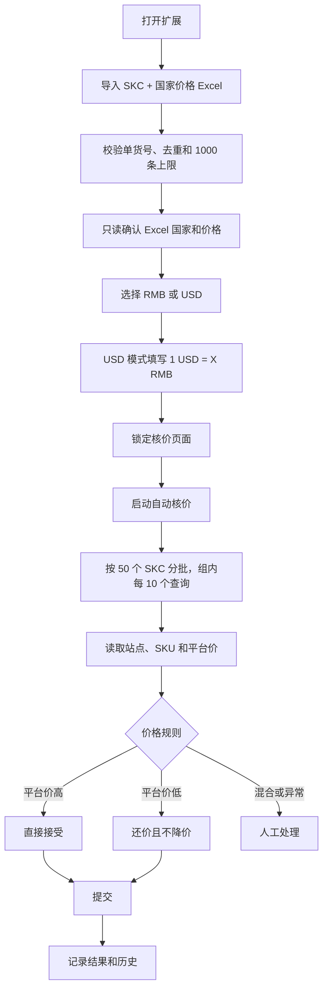

# Temu 全球价格申报核价助手 PRD

文档版本：v1.0
产品版本：0.8.0
日期：2026-11-12
状态：已实现，持续真实页面验收

## 1. 产品概述

Temu 卖家在「上新生命周期管理 → 价格申报中」批量确认或调整多站点、多 SKU 申报价格。人工处理存在漏 SKC、分页读取不完整、币种混淆、价格判断错误、重复提交和页面切换导致操作对象错误等风险。

本扩展在已登录的 Temu Agent Center 页面中运行，完成以下闭环：

1. 从双工作表 Excel 导入同一货号下的 SKC 和 59 个国家价格。
2. 按每批 50 个 SKC 生成任务，并锁定核价标签页。
3. 在页面设置每页 50 条、「待卖家确认」状态。
4. 查询 SKC、全选商品并打开「查看并确认申报价格」抽屉。
5. 完整读取站点、SKU 和平台价格。
6. 按人民币或美元模式比较用户申报价。
7. 平台价大于或等于申报价时直接接受；低于申报价时向平台还价。
8. 记录查询完整性、提交结果、失败项和重试信息。

## 2. 目标与成功标准

### 2.1 目标

- 单文件最多稳定处理 1000 个 SKC。
- 不因虚拟表格、分页、查询异步加载或残留抽屉漏读 SKC。
- 支持人民币和美元两种核价显示方式，USD 页面不会重复换算平台价格。
- 用户切换其他 Temu 后台标签后，核价、页面检查和暂停仍作用于原标签。
- 自动提交必须可追溯、可跳过已成功项，并在结果未知时停止。

### 2.2 成功标准

- 1000 个 SKC 按 50 条拆成 20 个批次。
- 每批内部按 10 个 SKC 查询组执行完整性校验和补查。
- SKC、站点、SKU、平台价格与页面展示一致。
- 查询后每个输入 SKC 均被归类为“返回”或“无待确认”，不得静默遗漏。
- 价格抽屉不得混入本批之外的 SKC。
- 已提交成功的 SKU 不因重试再次提交。
- 提交结果未知时不自动重试，先由用户核对平台。

## 3. 用户与范围

### 3.1 目标用户

- Temu 全托管或相关运营人员。
- 使用比特浏览器或 Chrome 登录 Agent Center 的卖家企业。
- 一次处理同一货号下大量 SKC 和多国家价格的运营团队。

### 3.2 本期范围

- Manifest V3 浏览器扩展和侧边栏界面。
- 目标页面：`https://agentseller.temu.com/newon/product-select`。
- `.xlsx` 双工作表导入；旧版 `.xls` 和不含国家价格的 CSV 不作为正常流程输入。
- 双工作表 Excel：`SKC导入`、`国家价格`。
- 59 个唯一站点，顺序为美国、欧盟 27 国、其他站点。
- 人民币和美元核价显示。
- 自定义汇率：`1 USD = X RMB`。
- 50 个 SKC 一个外层批次，内部 10 个 SKC 一个查询组。
- 页面结果稳定等待、虚拟列表滚动、补查和最终合并复核。
- 标签页锁定、安全暂停、成功项跳过和任务历史。
- 直接接受平台价、低价还价、混合高低价阻断。

### 3.3 不在本期范围

- 自动登录、验证码处理或安全验证绕过。
- 云端同步、多账号共享、团队权限和远程服务器存储。
- Temu 未公开 API 的稳定接入。
- 永久后台监听或定时自动扫描新任务。
- 其他币种作为用户录入币种。
- 混合高低价 SKU 的逐 SKU 自动拆分操作。
- 审计文件导出、结果 Excel 导出和单行取消提交。

## 4. 核心业务规则

### 4.1 价格来源

- Excel 中所有国家价格始终按人民币录入和保存。
- 人民币模式直接使用 Excel 的 RMB 价格。
- 美元模式要求用户填写 `1 USD = X RMB`。
- Excel RMB 价格显示为 USD：`USD = RMB ÷ 汇率`。
- 用户在 USD 界面输入的申报价保存时换算为 RMB 基准。
- Temu USD 页面返回的平台价按同一汇率换算到 RMB 基准比较。
- 平台为 CNY 页面时，不把 CNY 价格重复乘汇率。

### 4.2 国家启用

- 国家行填写了人民币价格时自动启用。
- 没有价格且标为“否”的国家保持禁用。
- 美国同样适用该规则。
- `最低接受价(RMB)` 和 `提交价格(RMB)` 是兼容旧模板的列名，产品含义分别为“申报价”和“可选还价目标”。

### 4.3 价格决策

| 条件 | 决策 | 页面动作 |
| --- | --- | --- |
| 平台价 ≥ 申报价 | 直接接受平台价 | 不修改平台价 |
| 平台价 < 申报价 | 还价 | 选择重新调整报价，填写目标价后提交 |
| 同一站点/SKC 的 SKU 价格跨越申报价两侧 | 人工处理 | 排除该组，避免整组误改 |
| 价格或汇率无效 | 阻断 | 不提交 |
| SKU 已成功提交 | 已提交 | 默认跳过 |

默认大于等于时直接接受；用户可切换为严格大于。严格大于时，相等价格进入还价逻辑。

### 4.4 查询完整性

外层批次最多 50 个 SKC，内部拆为 5 个查询组，每组最多 10 个。每组执行：

1. 清除旧商品选择。
2. 等待页面结果数量稳定。
3. 滚动虚拟商品表，收集本组返回的 SKC。
4. 对未返回项补查一次。
5. 对已有返回项进行最终合并复核。
6. 将最终未返回项记录为“无待确认”。

最终合并查询必须返回全部已发现 SKC，否则批次失败并重试，不能把部分结果记为完成。

## 5. 用户流程

## 6. 功能需求

### FR-01 Excel 导入

- 正常流程支持双工作表 `.xlsx`；明确拒绝旧版 `.xls` 和缺少国家价格表的 CSV。
- 支持两个工作表，自动读取 SKC 和 59 个国家价格。
- 自动识别中英文表头别名。
- SKC ID 必须为文本格式，阻止科学计数法。
- 同文件只允许一个货号。
- 重复 SKC 去重并提示数量。
- 有效 SKC 上限 1000 个。
- 空白模板行忽略。
- 国家价格非空时自动启用。

### FR-02 状态恢复

- 自动恢复最近一次 SKC、国家、价格、币种、汇率和规则。
- 数据只保存在 `chrome.storage.local`。
- 任务历史保存最近 30 次，显示完成、失败、未知和暂停。
- 历史记录包含查询数、返回数、无待确认数、提交数和明细。

### FR-03 币种与汇率

- 核价币种可选 RMB 或 USD。
- USD 模式显示汇率输入框，标签固定为 `1 USD = X RMB`。
- 汇率为空、0、负数或非数字时禁用开始按钮。
- 币种和汇率随最近导入状态自动保存。
- 切换币种后，价格输入和预览表头同步改变。

### FR-04 页面锁定

- 用户可点击“锁定当前核价标签页”。
- 页面检查或开始核价时，如尚未锁定则自动锁定当前目标标签。
- 检查、开始和暂停使用保存的标签 ID，不使用当前活动标签。
- 锁定标签关闭或离开 `/newon/product-select` 时自动解锁并提示。
- 执行期间禁止重新锁定或解除。
- 用户可以切换到其他 Temu 后台标签，任务继续面向原核价标签。

### FR-05 页面准备

- 仅在目标页面启用。
- 设置每页 50 条。
- 设置「待卖家确认」。
- 关闭残留价格抽屉。
- 清除旧商品选择。
- 页面检查读取分页输入框的实际值，不仅依赖页面文字。

### FR-06 分批与查询

- 外层最多 1000 个 SKC、每批 50 个。
- 内部每 10 个一个查询组。
- 查询结果数量稳定后才读取。
- 支持虚拟表滚动。
- 未返回项补查。
- 所有已返回项最终合并复核。
- 每批结果必须满足完整性门槛。

### FR-07 抽屉读取与校验

- 读取当前批次的站点、SKU 和平台价。
- 从表头识别页面价格币种：USD、CNY/RMB。
- 校验抽屉 SKC 均属于本批已返回 SKC。
- 校验抽屉组数与页面显示一致。
- 同站点/SKC 混合高低价时阻断该组。
- 读取失败不提交。

### FR-08 提交

- 直接接受项保留平台价。
- 还价项填写目标价。
- 所有提交前等待明确抽屉和按钮状态。
- 提交结果未知时立即停止自动重试。
- 重新运行默认跳过已成功 SKU。

### FR-09 暂停

- 任务执行中显示“暂停任务”。
- 暂停请求发送到锁定标签。
- 查询、扫描和还价阶段可安全取消。
- 已开始「全部提交」后不允许危险中断，等待明确结果。

## 7. 页面与交互

侧边栏按以下顺序呈现：

1. 导入 SKC 和下载完整模板。
2. 只读确认 Excel 导入的国家和价格。
3. 选择币种、填写汇率和选择价格规则。
4. 页面检查与标签锁定。
5. 批次计划和任务执行。
6. 核价预览、汇总和历史。

关键状态必须可见：

- 有效 SKC、批次数和重复数。
- Excel 启用的国家数。
- 当前币种和汇率。
- 已锁定标签标题。
- 当前批次和当前查询组。
- 导入数、返回数、无待确认数和提交数。

## 8. 异常处理

| 场景 | 处理 |
| --- | --- |
| 登录失效 | 停止并要求重新登录 |
| 当前标签不是核价页 | 不锁定，提示切换 |
| 锁定标签已关闭 | 自动解锁，停止任务 |
| 分页或状态无法设置 | 批次失败，有限重试 |
| 查询缺少 SKC | 补查，再失败则阻止完成 |
| 残留抽屉 | 开始批次前关闭 |
| 抽屉混入旧 SKC | 阻止提交 |
| 页面币种为 USD 但没有汇率 | 阻断 |
| 提交结果未知 | 标记 unknown，禁止自动重试 |
| 用户暂停 | 未提交阶段取消；提交阶段等待结果 |

## 9. 验收标准

- 1000 个 SKC 正确拆为 20 批。
- 单批 50 个 SKC 正确拆为 5 个 10 条查询组。
- 查询组中所有 SKC 都被归类为返回或无待确认。
- 100 个 SKC 的文件能完整预览，不出现只处理 2 个仍报完成。
- 标签锁定后切换其他 Temu 页，检查和暂停仍发往原标签。
- `168.75 RMB` 在 `7.20` 汇率下显示 `23.44 USD`，比较基准不漂移。
- USD 页面平台价 `20.69`、目标 `21.00` 时执行还价；目标 `10.00` 时直接接受。
- 测试、构建和文档版本保持一致。

## 10. 当前限制与后续候选

- 仍需完成 1000 个真实 SKC 的完整回归。
- 页面结构变化可能导致选择器失效，必须 fail closed。
- 混合高低价 SKU 目前人工处理。
- 汇率由用户手工填写，不自动联网更新。
- 当前没有永久监控模式，每次任务需手动启动。
- 审计导出、单行取消、结果 Excel 导出尚未实现。

## 11. 文档维护

- 每次行为变化必须同步更新本 PRD。
- 技术实现变化必须同步更新 `docs/TECHNICAL_DESIGN.md`。
- 每次版本发布必须同步 `docs/DEVELOPMENT_STATUS.md`、README、manifest 和侧边栏版本。
- 文档不得把计划能力写成已实现能力。
