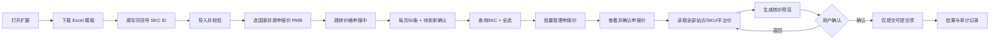

# 全球价格申报核价助手 PRD

文档版本：v0.1  
日期：2026-10-22  
状态：预研与虚拟验证

## 1. 背景与目标

Temu 卖家在「上新生命周期管理 → 价格申报中」逐条查看平台申报价，并判断是否接受。商品可能包含多个 SKC、多个站点和多个 SKU，人工核对容易出现漏看、币种混淆、重复提交和错误接受低报价。

本产品提供一个运行于卖家后台的浏览器扩展，完成以下闭环：

1. 用户选择本次要核价的国家，并填写每个国家的申报价（RMB）。
2. 用户下载 Excel 模板，录入同一货号下的 SKC ID，单个文件最多 1000 个。
3. 扩展将 SKC 自动拆为每批 50 条，逐批在商品 ID 查询中执行，将列表设置为每页 50 条并筛选「待卖家确认」。
4. 扩展全选商品，打开「批量管理申报价 → 查看并确认申报价格」。
5. 扩展读取弹窗中全部站点和 SKU 的平台价，与用户申报价比较。
6. 扩展对高价直接接受，对低价实际还价后提交。

### 成功指标

- 1000 个 SKC 可稳定拆分为 20 批，每批最多 50 条。
- 价格读取准确率 100%，不得出现站点、SKU、币种或金额错配。
- 符合规则的 SKU 提交成功率达到 99% 以上。
- 重复提交率为 0。
- 任何自动提交均可追溯到 SKC、SKU、站点、平台价、申报价、还价目标和提交时间。

## 2. 用户与范围

### 主要用户

Temu Agent Center 运营人员，在已登录的比特浏览器或普通 Chrome 中批量处理全球站点价格申报。

### 本期范围

- Chrome Manifest V3 扩展。
- Temu `agentseller.temu.com` 的「上新生命周期管理全球」页面。
- Excel/CSV 模板下载、导入和 SKC 校验。
- 多国家选择及 RMB 申报价参数。
- 提供 59 个站点的选择列表，流程分为“选择国家”和“填写价格”两步。
- Excel 模板包含 `SKC导入` 和 `国家价格` 两个工作表。
- 国家价格表支持申报价、还价目标和启用状态。
- 支持最近方案自动恢复及命名方案保存、载入、删除。
- 任务历史保留完成、失败、结果未知状态，并支持重试安全失败任务。
- 最多 1000 条 SKC 导入，自动按 50 条单批查询。
- 待卖家确认商品的查看与申报价确认。
- 本地核价预览、提交结果、错误记录和审计日志。

### 非本期范围

- 自动登录、绕过验证码或规避平台风控。
- 修改 Temu 后端接口或页面之外的数据。
- 多账号共享、云端同步和团队权限管理。
- 自动处理同一文件内超过 1000 条的历史 SKC；本期单文件上限 1000 条，页面每次查询 50 条。
- 对未知或变化的页面结构进行无人值守提交。

## 3. 术语与假设

| 术语 | 定义 |
| --- | --- |
| 货号 | 用户内部用于归组同一商品的编码 |
| SKC ID | Temu 商品/SKC 查询 ID |
| SKU | 某站点下可独立申报价格的最小单元 |
| 申报价 | 用户为该国家填写的人民币目标价，也是平台价偏低时的还价目标 |
| 平台价 | Temu 在申报确认弹窗中给出的价格 |
| 平台价 RMB | 平台直接显示的人民币值，或按明确汇率换算后的值 |
| 直接接受 | 平台价 RMB 大于或等于申报价，保留平台价提交 |
| 还价提交 | 平台价 RMB 小于申报价，改为目标价后提交 |
| 批次 | 一次在页面中查询的 SKC 集合，最多 50 个 |

默认假设：

- 同一文件只导入同一货号下的 SKC；如果出现多个不同货号，扩展停止并提示用户修正。
- 用户填写的申报价是该国家本批次所有 SKU 共用的价格参数。
- 平台价不低于申报价时直接接受平台价，不再下调到申报价。
- 平台价低于申报价时自动向平台还价，默认还价目标等于申报价。
- 同一站点/SKC 的 SKU 价格跨越申报价时停止该组自动处理，避免把高价 SKU 一并下调。
- 比较前必须将平台价统一换算为人民币；无法可靠换算时不得提交。

## 4. 用户流程

## 5. 功能需求

### FR-01 Excel 模板

- 扩展提供「下载模板」按钮，生成 `.xlsx` 文件。
- `SKC导入` 工作表包含：`货号`、`SKC ID`、`启用`、`备注`。
- `国家价格` 工作表包含：`国家代码`、`国家名称`、`分组`、`启用`、`最低接受价(RMB)`、`提交价格(RMB)`、`提交方式`、`备注`。表头为兼容旧模板保留，含义分别是申报价与还价目标价。
- `国家价格` 工作表预置 59 个唯一站点，所有价格字段均为 RMB。
- `SKC ID` 必填；`启用` 默认为 `是`。
- 模板内提供字段说明；国家价格默认为空。填写人民币价格后自动启用该国家，未填写价格时保持禁用。
- 模板下载不依赖外部服务，不收集用户数据。

### FR-01A 方案记忆

- 自动恢复最近一次的 SKC、国家、申报价、还价目标和规则。
- 支持按名称保存、载入、删除多套核价方案。
- 方案只保存在 `chrome.storage.local`，不上传远程服务器。

### FR-01B 重复核价与重试

- 任务历史记录完成、失败和提交结果未知。
- 重复核价会重新读取平台价，默认跳过已经提交成功的 SKU。
- 提供“强制重新处理已成功项”开关。
- 提交前的页面失败最多自动重试 3 次，间隔约 3 秒和 8 秒。
- 登录失效、人工校验错误和提交结果未知不自动重试。

### FR-02 SKC 导入与校验

- 支持导入 `.xlsx`、`.xls`、`.csv`；粘贴导入可作为辅助入口。
- 一次最多导入 1000 个启用状态的有效 SKC ID。
- 程序按导入顺序自动拆为每批最多 50 条。
- 自动去除首尾空白和 Excel 数字格式造成的异常字符。
- 重复 SKC 自动去重，并在预览中显示去重数量。
- 只允许一个货号。发现多个货号时阻止进入下一步。
- 发现空值、超长 ID、非字母数字字符或超过 1000 条时，逐行指出问题。
- 展示总数、有效数、重复数和无效数。

### FR-03 国家选择与价格参数

- 国家列表从当前确认弹窗可用的站点动态读取；读取前提供预设列表供预填。
- 用户可多选国家，至少选择一个。
- 国家选择完成后进入独立价格填写页面，只展示本次勾选的国家。
- 内置 59 个唯一站点；重复出现的约旦只保留一次。
- 每个选中项必须填写申报价，货币单位为 RMB。
- 价格最多两位小数，必须大于 0。
- 支持将同一价格批量应用到多个国家，也允许逐国修改。
- 尚未选中任何国家时不能开始核价。

### FR-04 页面准备与查询

- 仅在 Temu 卖家后台目标页面启用操作。
- 将分页大小设置为 50。
- 将申报价格状态设置为「待卖家确认」。
- 在商品 ID 查询中输入当前批次 SKC，每批最多 50 条。
- 输入 1000 条时依次执行 20 批，并记录每批成功、失败和跳过数量。
- 查询后校验页面行数与预期 SKC 是否一致；缺失 SKC 需单独列出。
- 扩展不得在页面结构不匹配时盲目点击。

### FR-05 全选与打开确认弹窗

- 仅勾选当前页商品信息区域的商品选择框。
- 选择「批量管理申报价 → 查看并确认申报价格」。
- 打开弹窗后先只读扫描，不执行提交。
- 如果页面显示确认或安全提示，保存提示文本并暂停自动操作，等待用户处理。

### FR-06 读取全部站点与 SKU

- 读取行应至少包含：SKC ID、SKU ID、站点、平台原币种、平台价格、平台价格 RMB、当前状态。
- 支持站点的横向展开或纵向明细，不得只读取当前可视区域。
- 读取完成后校验：
  - 每个 SKU 至少有一个国家价格；
  - 金额和币种成功解析；
  - SKU 与站点组合唯一；
  - 弹窗行数与页面来源一致，或明确记录差集。
- 无法识别的字段标记为 `BLOCKED`，不得用默认值猜测。

### FR-07 核价规则

默认采用自动接受/还价规则：

| 条件 | 结果 | 动作 |
| --- | --- | --- |
| 平台价 RMB > 申报价 | 直接接受 | 保留平台价并提交 |
| 平台价 RMB = 申报价 | 直接接受 | 保留平台价并提交 |
| 平台价 RMB < 申报价 | 还价提交 | 选择重新调整报价，将还价目标价填为新申报价并提交 |
| 同一站点/SKC 同时出现高于和低于申报价的 SKU | 人工处理 | 排除该组，不进行可能误改高价 SKU 的整组还价 |
| 价格、币种或汇率不明确 | 阻断 | 不提交并提示原因 |
| SKU 已确认或状态不允许修改 | 跳过 | 记录平台反馈 |

严格大于选项只影响“平台价等于申报价”时是直接接受还是还价；默认大于等于直接接受。

### FR-08 核价预览

- 在提交前显示全部 SKU 的价格对照表。
- 可按结果筛选，但默认必须让用户看到「直接接受」「低价还价」「人工处理」「阻断」四类数量。
- 每行显示平台价、申报价、实际提交价、差额、站点、SKU 和来源状态。
- 对「可提交」行支持单行取消勾选。
- 显示最终将提交的 SKU 数和总金额，不代表支付总价。
- 页面结构、SKC 列表、国家参数在扫描后发生变化时，必须重新扫描。

### FR-09 提交

- 用户点击「提交 N 项」后才执行最终提交。
- 提交前再次确认：目标账号、SKC 数量、站点数量、可提交 SKU 数。
- 提交时逐行处理并等待每一行的结果，避免并发点击造成错位。
- 页面二次弹窗、风控提示或验证码出现时立即停止。
- 所有平台提示、成功项和失败项均写入结果页。

### FR-10 幂等与审计

- 为每个批次和 SKU 生成稳定的幂等键，包含货号、SKC、站点、SKU、平台价和申报价。
- 同一任务重复运行不得再次提交已成功项。
- 审计日志保存在扩展本地存储，可导出 CSV。
- 日志不得存储登录 Cookie、会话令牌、密码或页面完整 HTML。

## 6. 页面与交互要求

### 扩展主界面

使用 Chrome 侧边栏承载流程，顺序为：

1. 模板与 SKC 导入
2. 国家与申报价
3. 页面检查
4. 核价预览
5. 提交结果

侧边栏关闭后任务状态保留；页面刷新后需重新检查并扫描，不可沿用旧页面快照直接提交。

### 关键提示文案

- 「平台价不低于申报价时直接接受；平台价低于申报价时自动向平台还价。」
- 「高价 SKU 保留平台价，不会为了核价而主动下调。」
- 「本批只允许一个货号；请确认 Excel 中所有 SKC 属于同一货号。」
- 「发现页面结构变化，为确保价格准确，本次提交已停止。」

## 7. 异常处理

| 场景 | 处理 |
| --- | --- |
| 登录过期 | 提示重新登录，不尝试绕过 |
| 页面不是目标路由 | 显示当前页面与正确入口 |
| 分页或状态无法设置 | 停止并显示可复制的检查结果 |
| SKC 查询缺失 | 列出缺失项，允许用户返回修正 |
| 弹窗未出现 | 停止，不自动重试超过一次 |
| 站点字段无法识别 | 标记阻断并停止该 SKU |
| 汇率缺失/过期 | 停止换算；禁止把原币金额当 RMB |
| 提交按钮多次出现 | 使用幂等键和运行锁避免重复 |
| 提交结果未知 | 标记 `UNKNOWN`，禁止自动重试，要求用户刷新核实 |

## 8. 验收标准

### 必须通过

- 导入 1000 个 SKC 时拆成 20 批，无遗漏、无重复、无顺序错配。
- 同一货号校验可阻止混合货号。
- 4 个国家价格参数可正确应用到全部 SKU。
- 平台价高于、等于、低于申报价的自动接受与还价边界通过测试。
- 混合高低价的站点/SKC 会阻断，不会整组误改。
- 直接接受、还价、阻断和已提交数量等于明细行统计。
- 提交前预览必须出现，未经点击确认不会提交。
- 网络或页面中断后不会重复提交已成功项。

### 真实账号逐步验收

1. 只读扫描：设置筛选、查询、打开弹窗并读取，不点击提交。
2. 单行演练：选择 1 个 SKC、1 个可提交 SKU，人工核对后提交。
3. 小批量：5 个 SKC，多站点但不超过 20 个 SKU。
4. 上限批量：1000 个 SKC，按 20 批执行，观察耗时、页面性能和结果一致性。

## 9. 待确认项

- 确认目标窗口重定向到登录页是登录态过期，还是需要使用「中国地区」入口完成认证。
- 确认确认弹窗中平台价是否直接提供 RMB 字段；若只有当地币种，必须确定平台汇率来源。
- 已确认平台价大于或等于申报价时直接接受，低于申报价时向平台还价。
- 同一站点/SKC 的 SKU 价格跨越申报价时先人工处理。
- 确认同一 SKC 在同一国家存在多个 SKU 时，价格参数是否共用，或需要 SKU 级覆盖。
