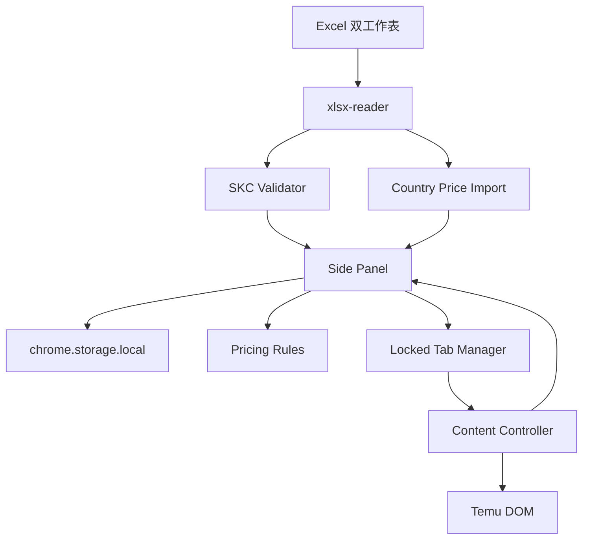
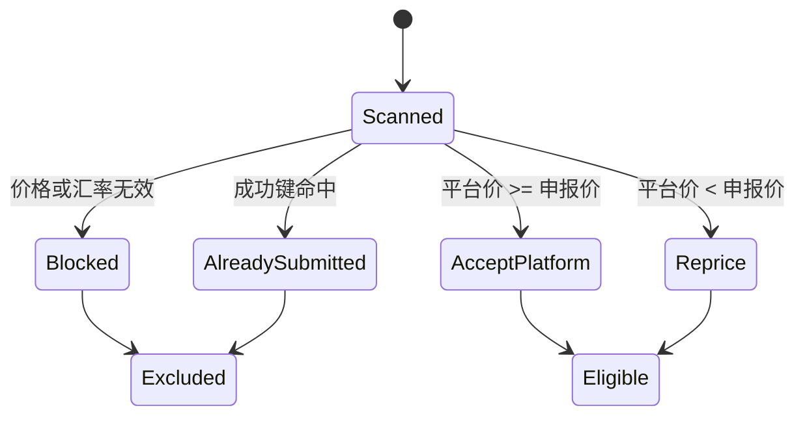

# Temu 全球价格申报核价助手技术设计

文档版本：v1.0
产品版本：0.8.0
日期：2026-11-12

## 1. 技术结论

当前路线为：

> Manifest V3 侧边栏扩展 + DOM 内容脚本 + 本地价格规则 + Excel 双工作表解析 + Chrome 本地存储。

不依赖远程服务、Cookie 搬运、未公开接口或远程脚本。页面操作复用用户当前登录会话。

核心设计约束：

- 页面数据读取不完整时不得提交。
- 页面币种未识别或汇率无效时不得提交。
- 标签页锁定后，所有页面操作使用锁定标签 ID。
- 提交结果未知时停止，不做自动重试。

## 2. 运行环境

- Chromium 148，Manifest V3。
- 目标域：`https://agentseller.temu.com/*`。
- 目标路由：`/newon/product-select`。
- 扩展使用 `chrome.sidePanel`、`chrome.storage.local`、`chrome.tabs` 和下载模板能力。
- 比特浏览器窗口和调试端口随实例变化，不写死在扩展运行时中。

## 3. 代码结构

```text
extension-src/
  manifest.json
  background.js
  sidepanel/
    sidepanel.html
    sidepanel.css
    sidepanel.js
  content/
    content.js
  shared/
    countries.mjs
    pricing.mjs
    skc.mjs
    xlsx-reader.mjs
  assets/
    import-template-v2.xlsx
    skc-template-1000.xlsx
src/core/
  countries.mjs
  pricing.mjs
  skc.mjs
src/shared/
  xlsx-reader.mjs
```

`tools/build-extension.mjs` 将扩展源和共享模块复制到 `dist/extension`，并检查 manifest 和必需文件。

## 4. 组件架构



### 4.1 Side Panel

职责：

- 文件导入、SKC 校验和批次展示。
- 59 个受支持站点的只读导入摘要。
- RMB/USD 币种切换和汇率输入。
- Excel 导入参数与任务历史持久化。
- 标签页锁定和页面诊断。
- 启动、暂停和重试任务。
- 展示核价明细与汇总。

### 4.2 Background Service Worker

只负责侧边栏打开行为：

- `chrome.sidePanel.setPanelBehavior({openPanelOnActionClick:true})`。
- 不持有页面句柄，不执行价格规则。
- MV3 休眠不影响内容脚本中的已启动任务。

### 4.3 Content Controller

职责：

- 校验目标路由和登录页面。
- 设置分页和「待卖家确认」。
- 清理残留抽屉和商品选择。
- 查询 SKC、读取虚拟表格、补查和合并复核。
- 全选商品、打开价格抽屉、筛选站点。
- 读取页面的站点、SKU 和平台价。
- 根据页面币种执行换算。
- 填写还价目标、提交和记录结果。
- 响应页面检查、开始、暂停消息。

### 4.4 Shared Modules

- `skc.mjs`：SKC 清洗、单货号校验、去重、50 条分批、查询完整性辅助函数。
- `countries.mjs`：59 个站点、国家行价格和自动启用判断。
- `pricing.mjs`：金额分、RMB/USD 换算、价格决策、幂等键和提交计划。
- `xlsx-reader.mjs`：内置 ZIP/XML 解析，不加载外部依赖。

## 5. 标签页锁定

### 5.1 问题

旧实现每次都通过 `chrome.tabs.query({active:true,currentWindow:true})` 选择标签页。用户切换到其他 Temu 页后：

- 页面检查可能作用于错误页面。
- 开始核价可能发给错误标签。
- 暂停请求可能无法到达原内容脚本。

### 5.2 当前实现

- 用户可点击“锁定当前核价标签页”。
- 页面检查或开始核价时，如未锁定则自动锁定当前目标页。
- 锁定对象包含 `id`、`windowId`、`url` 和 `title`。
- 后续检查、开始和暂停使用 `chrome.tabs.get(lockedTab.id)` 和该 ID 的 `sendMessage`。
- 锁定标签 URL 必须严格匹配 `/newon/product-select`。
- 标签关闭或导航离开核价路由时清除锁定。
- 执行期间禁止重新锁定或解除。

锁定状态仅在当前侧边栏生命周期中存在，不持久化到跨浏览器重启状态。

## 6. Excel 与数据模型

### 6.1 输入工作表

`SKC导入`：

- 货号
- SKC ID
- 启用
- 备注

`国家价格`：

- 国家代码
- 国家名称
- 分组
- 启用
- 最低接受价(RMB)
- 提交价格(RMB)
- 提交方式
- 备注

兼容旧模板的列名含义：

- `最低接受价(RMB)`：申报价。
- `提交价格(RMB)`：可选还价目标，空值时使用申报价。

### 6.2 自动启用

国家行满足以下任一条件时导入：

- 启用列不是明确的否。
- 任一人民币价格字段非空。

因此美国行即使启用写为“否”，只要填写价格仍会自动启用。无价格且明确禁用的行忽略。

### 6.3 存储状态

`chrome.storage.local`：

- `temuPricingAssistantStateV1`：最近一次 SKC、国家、价格、币种、汇率和当前批次。
- `temuPricingProfilesV1`：旧版本兼容键，当前正常流程不提供命名方案编辑。
- `temuPricingJobHistoryV1`：最近 30 次任务。
- `temuPricingLastAudit`：最近任务明细。
- `temuPricingLastError`：最近一次内部失败诊断。

## 7. 币种换算

### 7.1 用户币种

Excel 始终是 RMB 来源数据。

RMB 模式：

```text
displayCents = rmbCents
```

USD 模式，汇率定义为 `1 USD = fxRate RMB`：

```text
displayUsdCents = round(rmbCents / fxRate)
rmbCents = round(displayUsdCents * fxRate)
```

内部使用整数分，避免浮点累计误差。若 USD 显示值未被用户修改，使用输入框保存的原始 `rmbCents`，避免仅切换币种造成一分钱漂移。

### 7.2 Temu 页面币种

抽屉表头优先识别：

- `原申报价格(USD)`、`新申报价格(USD)`、`US Dollar` → USD。
- `原申报价格(CNY)`、`原申报价格(RMB)` → CNY/RMB。
- 无明确表头时回退到用户显示币种。

页面价格统一转换到 RMB 基准：

```text
page CNY → platformRmbCents = pageCents
page USD → platformRmbCents = round(pageCents * fxRate)
```

还价时，目标价转换为页面输入币种：

```text
pageUnitCents = round(targetRmbCents / fxRate)  // USD 页面
pageUnitCents = targetRmbCents                 // CNY 页面
```

### 7.3 汇率校验

USD 模式必须满足：

```text
fxRate > 0
```

汇率无效时开始按钮禁用。批次运行时再次校验，不能仅依赖 UI。

## 8. SKC 分批与完整性

### 8.1 两层批次

- 外层批次：最多 50 个 SKC，最多 20 批。
- 内层查询组：最多 10 个 SKC，每批最多 5 组。

### 8.2 单组流程

1. 清除当前商品选择。
2. 查询组内 SKC。
3. 等待「共有 N 条」结果数量稳定。
4. 滚动虚拟商品表并收集请求范围内的 SKC。
5. 对未返回 SKC 进行补查。
6. 若存在返回项且曾补查，执行最终合并复核。
7. 返回 `returnedSkcIds`、`noPendingSkcIds` 和查询日志。

### 8.3 完成门槛

- 合并查询缺少已发现 SKC时抛错。
- 页面价格抽屉显示组数与读取组数不一致时抛错。
- 抽屉出现本组之外的 SKC 时抛错。
- 任一 SKC 必须归类为返回或无待确认。
- 不允许只处理部分 SKC 后标记完成。

## 9. 页面流程

### 9.1 分页与筛选

- 分页输入框只读值必须为 50。
- 点击「价格申报中」标签。
- 仅启用「待卖家确认」状态。
- 页面检查使用输入框 value 判断分页，不依赖页面文本中出现“每页 50”。

### 9.2 全选与抽屉

- 全选商品信息主表的表头复选框。
- 打开「批量管理申报价 → 查看并确认申报价格」。
- 按 Excel 中有价格并自动启用的站点过滤抽屉。

### 9.3 站点和 SKU 读取

- 支持虚拟滚动。
- 识别 SKC、SKU 标签、站点、原价和调整后价格。
- 以 `SKC + 站点 + SKU` 去重。
- 支持页面 CNY 或 USD 表头。
- 平台价记录同时保留页面分值和 RMB 基准分值。

## 10. 决策和提交

### 10.1 单行决策



### 10.2 站点组决策

- 组内包含阻断或已提交行：排除整个站点组。
- 组内全部需要还价：整组执行还价。
- 组内全部可直接接受：不修改价格。
- 组内同时存在直接接受和还价：阻断该组，避免组级控件误改高价 SKU。

### 10.3 提交

- 点击「全部提交(N项)」。
- 等待「确认提交」，点击确认。
- 等待抽屉关闭或出现「已提交」。
- 点击提交按钮后，不再允许暂停请求安全中断。
- 点击后异常标记 `UNKNOWN_SUBMIT_STATE`，禁止自动重试。

### 10.4 已提交跳过

- 成功明细使用 `skcId|siteName|skuLabel` 稳定键。
- 后续任务默认跳过历史成功键。
- 用户可勾选“强制重新处理已成功项”。

## 11. 重试

- 批次在未开始提交前失败，最多自动重试 3 次。
- 重试间隔约 3 秒和 8 秒。
- 登录失效不重试。
- 已开始提交后失败不重试。
- 结果未知任务禁止“重试上次任务”，先人工核对平台。

## 12. 暂停

- 内容脚本维护当前任务状态。
- `STOP_AUTOMATION` 只发送到锁定标签。
- 查询、扫描、补查和还价阶段检查取消标志。
- 进入提交阶段后设置 `cancelAllowed=false`。
- 暂停任务记录为 `cancelled`。

## 13. 权限

manifest 使用：

```json
{
  "permissions": ["storage", "sidePanel", "downloads", "tabs"],
  "host_permissions": ["https://agentseller.temu.com/*"]
}
```

不申请：

- `<all_urls>`
- cookies
- webRequest
- debugger
- 远程主机权限

## 14. 安全与隐私

- 不读取或上传 Cookie、Authorization、密码和完整页面 HTML。
- SKC、国家价格、汇率和任务记录只存储在浏览器本地。
- 不加载远程脚本或 CDN。
- 页面结构不明、金额不明、币种不明或完整性失败时停止。
- 页面二次确认、风控提示或验证码出现时停止自动操作。
- 用户必须在已授权账号和平台条款范围内使用。

## 15. 测试策略

### 15.1 自动化

```powershell
node --test tests/*.test.mjs
node tools/simulate.mjs
node tools/build-extension.mjs
```

覆盖：

- SKC 过滤、去重、单货号和分批。
- 价格分、RMB/USD 往返换算。
- 汇率缺失和非法值。
- 直接接受、相等和还价边界。
- 国家价格自动启用。
- 已提交和阻断项隔离。
- 双工作表解析。

### 15.2 浏览器验证

- 侧边栏运行时异常和横向溢出。
- 页面分页、筛选、查询和虚拟滚动。
- 残留抽屉清理。
- 查询组补查和合并复核。
- 标签锁定后切换其他 Temu 标签。
- USD 和 CNY 页面价格识别。
- 仅预览模式不提交。

### 15.3 真实页面分级

1. 只读页面检查。
2. 单 SKC、单站点预览。
3. 单 SKC、多站点预览。
4. 小批量实际提交。
5. 50 SKC 单批。
6. 1000 SKC / 20 批完整回归。

## 16. 当前已知限制

- 真实 1000 SKC 全量回归尚未完成。
- Temu DOM 或列顺序变化可能导致定位失败。
- 混合高低价 SKU 组仅能人工处理。
- 汇率是手工值，不自动更新。
- 当前不是常驻监控任务。
- 没有审计或结果 Excel 导出。
- 侧边栏只在任务执行期间保存标签锁定；浏览器重启后需重新锁定。

## 17. 文档与发布同步

每次更新必须：

1. 更新 PRD 中的需求或验收变化。
2. 更新本技术文档中的架构、算法、选择器、数据模型或限制变化。
3. 更新 `docs/DEVELOPMENT_STATUS.md` 的版本、日期、测试与真实页面结论。
4. 同步 manifest、侧边栏版本、README、扩展 README 和安装包文件名。
5. 运行自动测试和构建。

不得把未实现能力描述为已完成。
