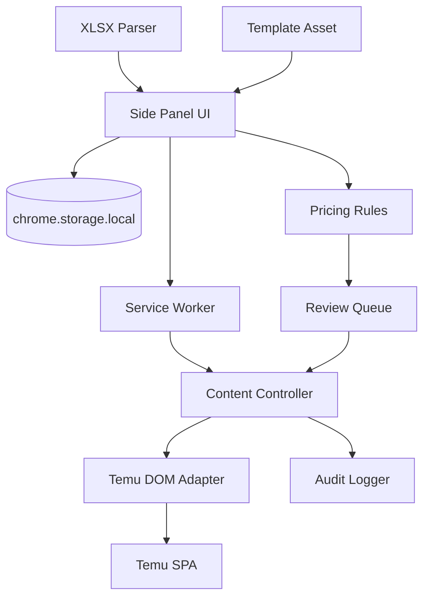
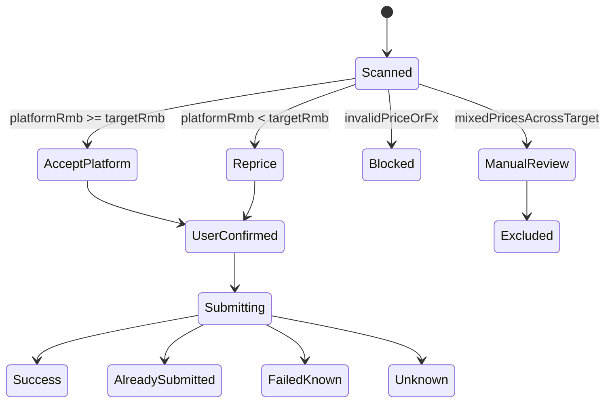

# 全球价格申报核价助手技术设计

文档版本：v0.2  
日期：2026-10-22

## 1. 结论

推荐路线为：

> Chrome Manifest V3 侧边栏扩展 + 页面 DOM 适配层 + 本地核价规则引擎 + 真实页面只读演练。

选择该路线的原因：

- 扩展直接复用用户已登录的 Temu 会话，无 Cookie 搬运。
- 页面 DOM 自动化与用户手工操作走同一条业务流程，提交链路可控。
- 侧边栏适合 Excel 导入、国家参数编辑和提交前复核。
- 不依赖未公开接口和令牌，安全边界比接口直连更清晰。
- Playwright 继续用于开发期 E2E 和比特浏览器验证，但不作为最终用户运行方式。

页面接口直连只保留为后续只读增强选项。未经接口稳定性、鉴权、风控和字段含义验证，不进入生产提交流程。

## 2. 浏览器运行条件

- 目标域：`https://agentseller.temu.com/*`
- 目标路由：`/newon/product-select`
- Chromium 148+，支持 Manifest V3 和 `chrome.sidePanel`
- 用户已在目标配置中完成 Temu 登录

当前比特浏览器配置：

- 配置 ID：`9e6f73cc742b4abc9015f31f8e75fbd7`
- 配置标题：`7512-Y2-18-工作台`
- 调试端口：`127.0.0.1:50262`
- 调试端点来自当前运行实例，重启后会变化，不应硬编码到扩展中。

## 3. 架构



### 3.1 Side Panel

职责：

- 导入模板及校验结果。
- 编辑国家申报价与还价目标。
- 使用“选择国家 → 填写申报价”的两步式流程，并提供 59 个站点。
- 读取双工作表模板并合并国家价格参数。
- 国家价格不为空时自动启用，包括“启用”列为“否”的美国行；没有价格的国家保持禁用。
- 保存命名核价方案到 `chrome.storage.local`。
- 保存最近 30 次任务状态，提交成功的 SKU 使用稳定键去重。
- 页面失败最多自动重试 3 次；登录失效和结果未知不进入自动重试。
- 展示页面扫描进度。
- 展示 SKU 价格对照、筛选和人工取消选择。
- 最终提交确认和结果导出。

状态保存在 `chrome.storage.local`。页面刷新后，页面扫描状态转为 `STALE`，必须重新扫描。

### 3.2 Service Worker

职责：

- 连接侧边栏、内容脚本和下载流程。
- 维护单任务运行锁。
- 监听标签页导航与关闭，终止过期任务。
- 触发审计日志导出。

Service Worker 不保存页面句柄，不长期持有敏感数据。MV3 空闲休眠后可从存储恢复任务元数据。

### 3.3 Content Controller

职责：

- 验证当前路由和页面准备状态。
- 调用元素定位器执行操作。
- 等待明确的页面状态，不依赖固定延时。
- 读取并规范化确认弹窗。
- 提交逐项执行；遇到未知状态立即暂停。

### 3.4 Temu DOM Adapter

定义稳定的适配接口：

```ts
interface TemuPriceDeclarationAdapter {
  detectPage(): Promise<PageState>;
  setPageSize(50): Promise<void>;
  setStatus("待卖家确认"): Promise<void>;
  querySkcs(skcIds: string[]): Promise<QueryResult>;
  selectAllVisibleProducts(): Promise<number>;
  openBulkPriceReview(): Promise<void>;
  scanReviewRows(): Promise<PlatformPriceRow[]>;
  submitApprovedRows(rows: ApprovedRow[]): Promise<SubmitResult[]>;
}
```

页面操作统一使用 `locator.ts`：

- 优先：`role`、`label`、可见文本、`name`、稳定的 `data-*` 属性。
- 次选：语义相邻关系和表格列标题。
- 最后：最小范围的 CSS 结构选择器。
- 不使用绝对 XPath、随机 class 或页面上第 N 个 `div`。
- 允许穿透开放的 Shadow DOM。
- 每个操作返回命中的元素描述，便于诊断。

## 4. 关键流程设计

### 4.1 SKC 导入

核心校验顺序：

1. 解析文件。
2. 识别表头别名。
3. 去除空白和 Excel 数字尾随字符。
4. 过滤未启用且没有价格的国家行。
5. 校验 SKC 格式。
6. 去重。
7. 校验单一货号。
8. 校验最多 1000 条，并按每批 50 条生成批次。

任何会导致目标集合不明确的问题都必须阻断流程。

### 4.2 页面准备

每步使用状态确认，而不是固定等待：

- 分页控件存在且值变为 50。
- 行数不超过 50。
- 状态筛选文本为「待卖家确认」。
- 查询结果至少存在一个商品或明确显示空状态。
- 全选后选中计数与当前可见行数一致。

### 4.2.1 SKC 查询完整性

每批开始前必须关闭残留价格抽屉并清除上次商品选择。批量查询不能以“任意一个 SKC 已出现”作为完成条件，而要执行以下门槛：

1. 等待页面结果总数连续稳定。
2. 滚动虚拟商品表格，收集本批请求范围内的全部 SKC。
3. 计算未返回 SKC，按每 10 个一组补查。
4. 对所有出现过结果的 SKC 做一次合并复核查询。
5. 打开价格抽屉后核对站点组总数，并拒绝本批范围之外的 SKC。
6. 将请求数、返回数、无待确认数、抽屉组数和提交数写入任务历史。

任何补查后仍无法合并返回的 SKC 均阻断任务，不能把部分处理记录为成功完成。

### 4.3 金额规范化

金额统一使用「分」的整数计算，避免 JavaScript 浮点误差：

```text
platformRmbCents = round(platformOriginalPrice * fxRateToRmb * 100)
floorCents = round(floorRmb * 100)
```

当平台直接提供 RMB 时，RMB 字段是首选，不进行二次换算。汇率必须包含：

- 来源
- 币种对
- 汇率
- 获取时间
- 是否手工录入

缺少任一项时结果为 `BLOCKED_FX`。

### 4.4 决策状态机



默认规则在平台价低于申报价时：

1. 把操作选择为「重新调整报价」。
2. 打开「补充商家调价原因」，选择「其他」并填写“按商家申报价还价”。
3. 在新申报价格中输入用户申报价；如单独设置了还价目标，则使用还价目标。
4. 提交该组价格。

平台价大于或等于申报价时，不打开调价操作，直接保留平台价并提交。同一站点/SKC 的 SKU 价格同时跨越申报价两侧时，组级调价控件无法保证逐个 SKU 保留高价，系统排除该组并要求人工处理。

用户可在任务执行期间请求暂停。暂停只在尚未开始提交时生效；一旦点击「全部提交」，中断会形成未知提交状态，系统会等待结果而不做自动重试。

### 4.5 幂等键

```text
SHA-256(accountFingerprint + productCode + skcId + site + skuId + platformRmbCents + floorRmbCents)
```

`accountFingerprint` 由店铺可见 ID 的哈希生成，不保存会话令牌。提交前检查本地成功记录；如果平台显示已确认，则标记 `ALREADY_SUBMITTED`。

## 5. 数据模型

```json
{
  "jobId": "local-uuid",
  "productCode": "Y2-18",
  "skcIds": ["741234567890"],
  "batchSize": 50,
  "batchCount": 20,
  "countries": [
    {
      "siteCode": "US",
      "siteName": "美国",
      "floorRmbCents": 5500
    }
  ],
  "comparisonPolicy": "STRICT_GREATER",
  "rows": [
    {
      "skcId": "741234567890",
      "skuId": "SKU-001",
      "siteCode": "US",
      "siteName": "美国",
      "currency": "USD",
      "platformPrice": 8.5,
      "platformRmbCents": 6120,
      "floorRmbCents": 5500,
      "decision": "APPROVED",
      "submittedPriceRmbCents": 5500
    }
  ],
  "status": "REVIEW_READY"
}
```

主要任务状态：

```text
DRAFT
IMPORT_VALIDATED
PARAMETERS_READY
PAGE_PREPARING
QUERY_READY
REVIEW_OPEN
SCANNING
REVIEW_READY
SUBMITTING
COMPLETED
PAUSED_FOR_USER
FAILED
```

## 6. 权限设计

建议 `manifest.json`：

```json
{
  "manifest_version": 3,
  "permissions": ["storage", "sidePanel", "downloads"],
  "host_permissions": ["https://agentseller.temu.com/*"],
  "content_scripts": [
    {
      "matches": ["https://agentseller.temu.com/newon/product-select*"],
      "js": ["content-controller.js"],
      "run_at": "document_idle"
    }
  ]
}
```

不申请 `<all_urls>`、`cookies`、`webRequest` 或 `debugger`。如需导出文件，使用 `downloads`；若通过 Blob 链接即可下载，则移除 `downloads`。

Excel 解析库必须打包在扩展内部，不能从 CDN 动态加载，以符合 MV3 CSP 并避免供应链变化。

## 7. 安全与合规

- 不读取或导出 Cookie、Authorization Header、密码和完整页面源码。
- 不在远程服务器保存 SKC、价格或账号信息。
- 不在页面结构不确定时自动提交。
- 汇率缺失、站点缺失、行数不一致均 fail closed。
- 所有点击必须带明确前置状态断言。
- 提交采用单线程顺序执行，禁止并发。
- 用户可随时暂停任务。
- 取得平台授权并遵守卖家后台条款；发布前确认自动化操作范围。

## 8. 测试策略

### 单元测试

- 模板解析和别名识别。
- SKC 清洗、去重、数量和单货号校验。
- 金额转分、汇率换算和边界比较。
- 决策状态与提交队列。
- 幂等键稳定性。

### 浏览器组件测试

- 模拟 Temu 页面使用自定义节点和开放 Shadow DOM。
- 验证分页、状态筛选、全选、批量菜单和确认弹窗定位。
- 模拟 SPA 重渲染，确认定位器会重新查找而不是使用失效节点。

### 端到端测试

- 使用 Playwright 对本地模拟页执行 50 SKC 单批流程，并验证 1000 SKC 拆成 20 批。
- 使用 `chromium.connectOverCDP()` 连接比特浏览器调试端口做受控烟测。
- 实际账号只读阶段、1 行提交阶段、小批量阶段和 1000 条/20 批阶段分开验收。

### 模拟与真实差异

模拟页面用于验证规则和交互顺序，不能证明 Temu 选择器可用。真实页面验收必须先完成只读 DOM 采集。页面发生结构变化时，模拟测试通过不代表线上可用。

## 9. 分阶段发布

### M0：当前预研

- PRD、技术文档、核心规则和虚拟测试。
- 确认需求歧义和账号状态。

### M1：只读扩展

- 侧边栏、模板导入、国家参数、页面准备、弹窗扫描和价差预览。
- 提交按钮禁用或 Dry-run。

### M2：受控提交

- 单账号、单批次、逐行提交、幂等和审计。
- 先 1 行、后 5 行，再验证 50 行。

### M3：稳定性增强

- 多页面版本适配。
- 审计导出、选择器健康检查和失败恢复。
- 只有在真实数据验证后才评估接口增强。

## 10. 开发期连接方式

当前设备可读取页面调试端点，但端口随浏览器重启变化。开发工具应动态发现：

1. 读取比特浏览器本地 API 获取已打开配置的调试信息。
2. 或从当前浏览器进程参数中发现调试端口。
3. 再通过 CDP 连接目标标签页。

生产扩展不依赖此端口。调试脚本只用于只读检查和 E2E 测试。
